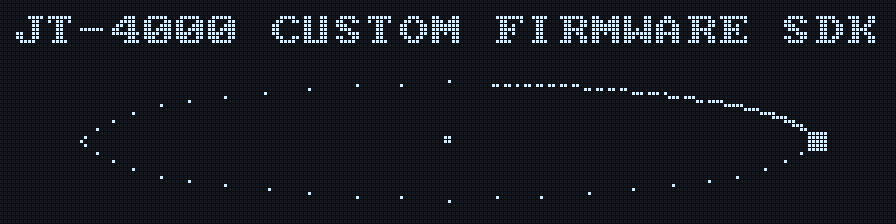
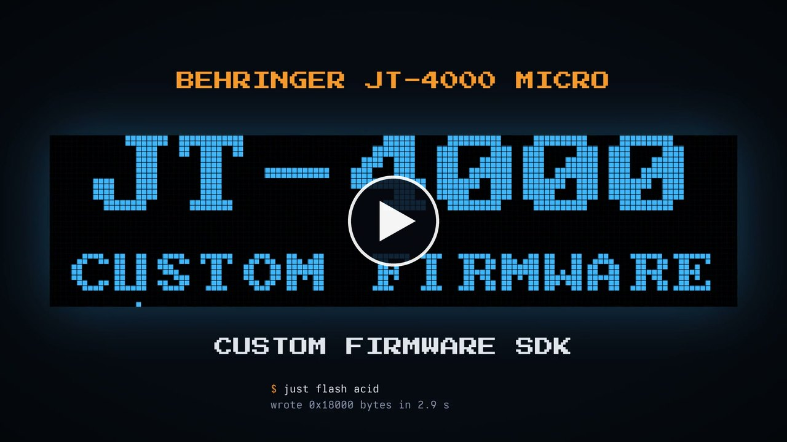
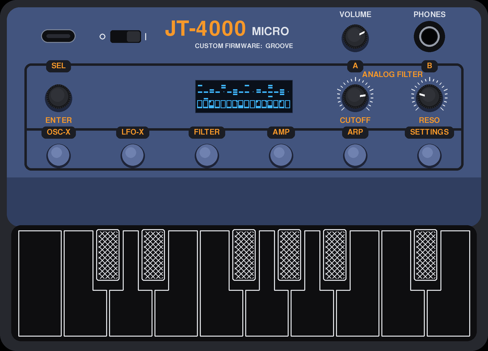
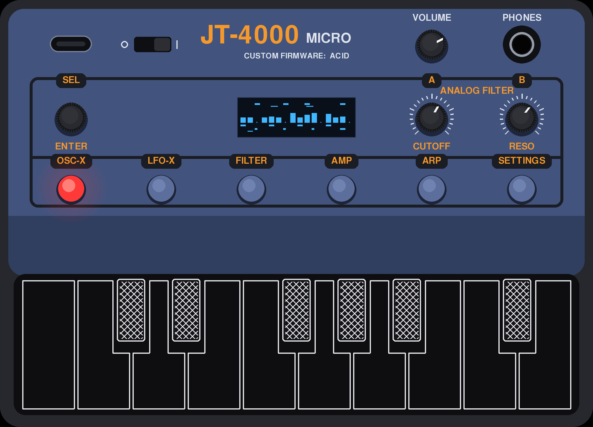
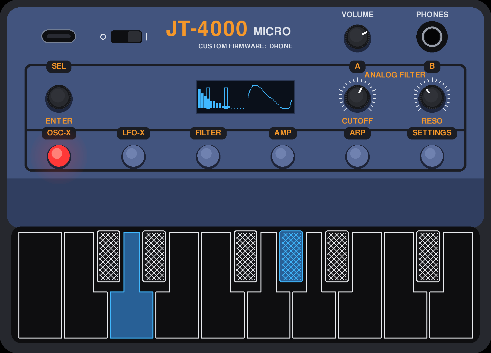
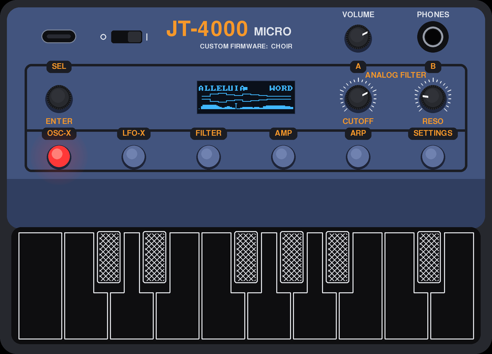
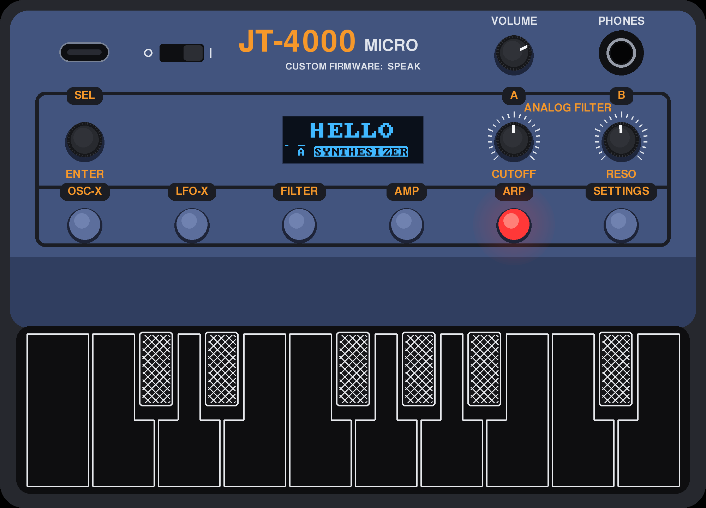
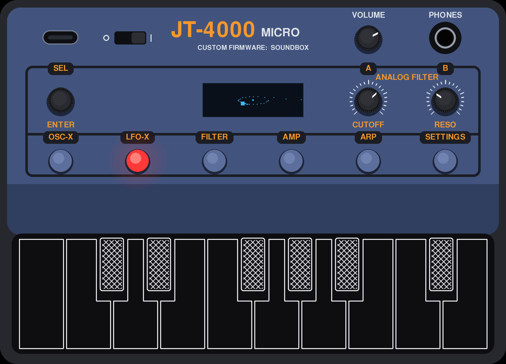
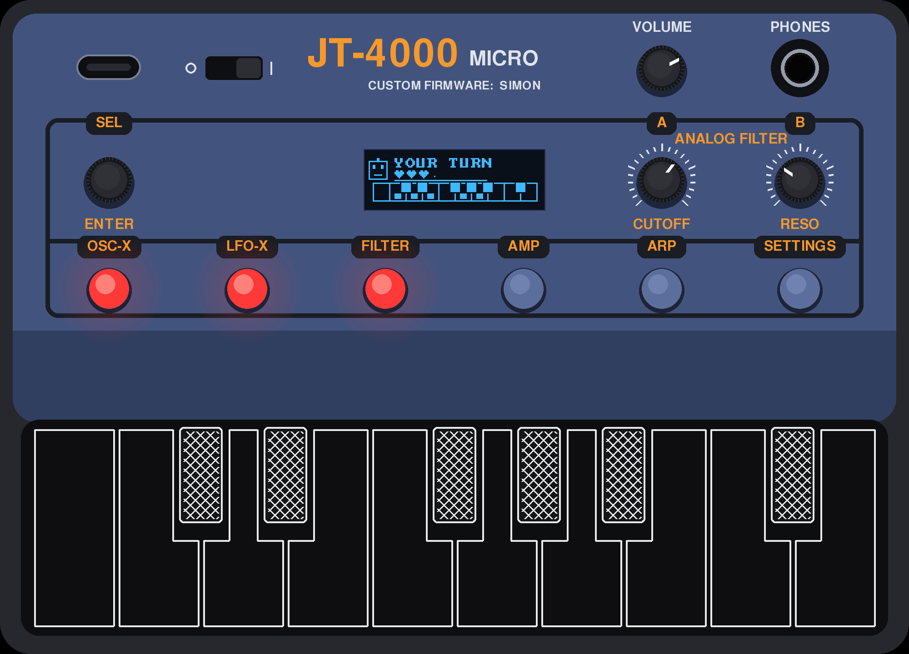
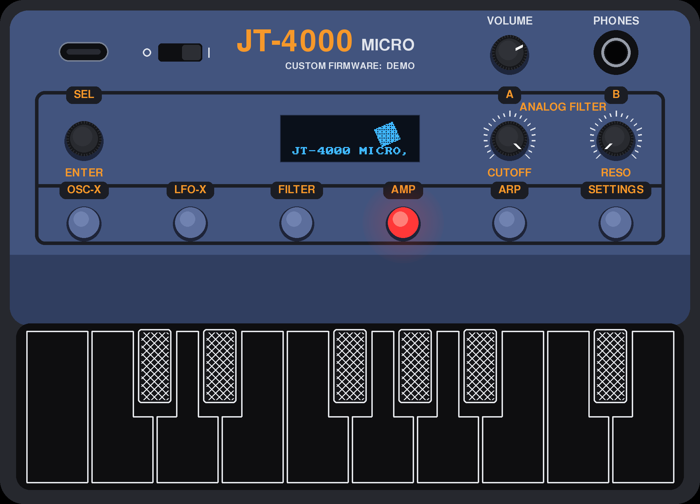

# JT-4000 Micro custom firmware SDK



A C SDK and a USB flasher for writing your own firmware for the Behringer JT-4000 Micro
synthesizer, with a simulator and a desktop window for trying it without the synth. Firmware
is flashed over the synth's own USB port in about three seconds.

[](https://youtu.be/6p2UCR0Uu50)

This repository holds two things:

- **`sdk/`**: a small C SDK. Display, lights, buttons, knobs, touch keyboard, 32 kHz audio
  out, the analog filter, USB MIDI, storage that survives power-off, sound building blocks
  (oscillators, envelopes, filter, delay, grains, reverb), Speak & Spell style speech and a
  menu system.
- **The reverse-engineering work behind it** (`docs/`, `tools/`, `ghidra/`): the firmware
  encryption, the bootloader's update protocol, the SysEx commands and the hardware map.

This project is unofficial and is not affiliated with or endorsed by Behringer / Music Tribe.
You flash your synth at your own risk; see [Safety](#safety-and-recovery) for why the risk is
small.

## Quick start

Requires `arm-none-eabi-gcc`, `make`, [`uv`](https://docs.astral.sh/uv/) and
[`just`](https://github.com/casey/just). Developed and tested on macOS. Not tested on Linux or
Windows; the only macOS-specific part is `fwfetch.py`'s default path to SynthTribe.

```sh
brew install arm-none-eabi-gcc arm-none-eabi-binutils uv just     # macOS
```

All commands run from the repository root. `just` on its own lists them.

```sh
just fetch            # download the stock firmware once, so you can go back
just flash acid       # build an example and flash it to the synth
just host acid        # or run it in a window on this computer, with sound
just new mysynth      # start your own in sdk/examples/mysynth, copied from hello
just stock            # flash the stock firmware again
```

Connect the synth by USB and switch it on before `just flash`. The flasher restarts the synth
into update mode by itself, from stock firmware and from SDK firmware. If it reports "synth not
found", hold **OSC + SETTINGS** while switching the synth on (the button lights blink) and run
the command again.

The stock firmware is Behringer's and is not part of this repository. `just fetch` downloads it
from Music Tribe's update server the way SynthTribe does.

### Examples

`just flash <name>` or `just host <name>` with one of these. Each has its controls in
`sdk/examples/<name>/README.md` or in the comment at the top of its `main.c`.

| Name | What it is |
|---|---|
| `acid` | A 303-style bassline machine with accent and slide |
| `groove` | A six-track groovebox: drums, bass, lead and a voice |
| `drone` | An additive drone: the 16 keys are 16 partials |
| `choir` | A pad made from frozen speech, up to four voices |
| `speak` | A talking typewriter: 267 words, spoken or sung at any note |
| `simon` | A memory game with melodies and a talking opponent |
| `trance` | A supersaw with a trance gate and built-in riffs |
| `soundbox` | An ambient sound box that plays itself |
| `demo` | A demoscene-style demo: music, pictures and speech, then a synth to play |
| `tone`, `hello`, `panel`, `bringup` | Small starting points and hardware tests |

### All commands

| Command | Does |
|---|---|
| `just apps` | List the examples |
| `just build <name>` | Build without flashing |
| `just flash <name>` | Build and flash |
| `just new <name>` | New firmware from `hello` |
| `just host <name>` | Run in the window |
| `just shot <name> [ms]` | Save a picture of the window after `ms` milliseconds |
| `just video <name> [ms] [file]` | Save a video with sound |
| `just sim <name>` | Run the ARM binary in the simulator and print the display |
| `just words <name>` | Rebuild a firmware's speech from its `words.txt` |
| `just fetch`, `just stock` | Download, and flash, the stock firmware |
| `just check` | Lint the tools and build every example |

Without `just`, the same builds are `make` targets inside `sdk/`; see
[`sdk/README.md`](sdk/README.md).

## Try it without the synth

`just host <name>` compiles a firmware's source for your computer and runs it in a window
drawn after the instrument, with sound. Click and drag the controls, press P for a
screenshot and R to record a video.

| | |
|---|---|
|  `groove` |  `acid` |
|  `drone` |  `choir` |
|  `speak` |  `soundbox` |
|  `simon` |  `demo` |

The window runs the firmware's real code on simulated hardware: the analog filter is a digital
approximation and there is no USB. `just sim <name>` runs the actual ARM binary, slowly and
without a window; use it to prove that a build runs. Judge sound on the synth.

## A firmware in twenty lines

```c
#include "jt4000.h"
#include "jt_dsp.h"

static jt_osc_t osc = {.wave = JT_WAVE_SAW};

static void render(int16_t *out, int n) {            /* called from the audio interrupt */
    for (int i = 0; i < n; i++) out[i] = (int16_t)(jt_osc_next(&osc) * 12000.0f);
}

int main(void) {
    jt_init();                                        /* clock, display, panel, knobs, keyboard */
    jt_usb_init();                                    /* USB MIDI; also lets `just flash` restart the synth */
    jt_audio_init(render);
    for (;;) {
        int key = jt_keyboard_lowest(jt_keyboard());
        if (key >= 0) jt_osc_hz(&osc, jt_note_hz(47 + key), JT_SAMPLE_RATE);
        jt_filter(jt_pot(JT_ADC_CUTOFF) / 4, jt_pot(JT_ADC_RESONANCE) / 4);
        jt_delay_ms(10);
    }
}
```

The full API is in [`sdk/README.md`](sdk/README.md) and the headers in `sdk/include/`.

## What you are working with

| | |
|---|---|
| Processor | STM32G431KBT6: Cortex-M4 with FPU, 170 MHz |
| Memory | 96 KiB of flash for your firmware, 32 KiB of RAM |
| Audio | 12-bit DAC, 32 kHz, mono, followed by the analog filter |
| Display | 128 × 32 OLED (16 × 4 characters) |
| Controls | 16 touch keys, 6 lit buttons, a push encoder, cutoff and resonance knobs |
| Connection | USB (MIDI when running, serial in update mode) |

The analog filter comes after the DAC, so it filters everything, digital effects included.
32 KiB of RAM holds about half a second of delay memory at 16 kHz.

Everything in the SDK has run on a real JT-4000 Micro.

The JT-4000M (the version with a MIDI socket) has the same processor and firmware format. An
SDK image detects it at start-up, moves the display's data/command line to the JT-4000M's pin
and delivers the socket's MIDI through `jt_midi_get`. This is built from the JT-4000M's stock
firmware and runs in the simulator (`tools/emu.py --board m`); it has not been tried on a
JT-4000M. `tools/flash.py` refuses to put one synth's stock firmware on the other.

## Safety and recovery

The factory bootloader lives in the first 32 KiB of flash and is never touched by flashing.
It checks the firmware image before starting it and offers three ways into update mode:

1. Hold **OSC + SETTINGS** while switching on. This works whatever firmware is flashed.
2. If an image fails its check (after an interrupted flash), the synth starts in update mode.
3. Running firmware asks for it (the stock firmware over SysEx, SDK firmware the same way).

A broken firmware is recovered by holding **OSC + SETTINGS** at power-on. The only code that
can do permanent damage is code that writes to flash below `0x08008000`; the SDK contains none.

Your presets are stored in a separate memory chip (an EEPROM). The SDK's storage functions use
only a part of it that the stock firmware never touches, so presets survive custom
firmware. Firmware that writes the chip directly might overwrite them. Back up first, on stock
firmware, with `uv run tools/sysex.py dump presets -o dumps/all-presets.syx`.

## Repository map

| Path | Content |
|---|---|
| `sdk/` | The SDK, its examples and its own README |
| `tools/` | `fwfetch.py` (download stock firmware), `flash.py` (flasher), `fwpack.py` (packaging, encryption), `emu.py` (simulator), `sysex.py` (talk to stock firmware), `riff.py` (MIDI file to riff for `examples/trance`), `lpcwords.py` (word list to LPC speech), `panel.py` (the synth in a window) |
| `docs/` | `HARDWARE.md` (pins, parts), `BOOTLOADER.md` (start-up rules, update protocol), `FIRMWARE.md` (image format, encryption), `SYSEX.md`, `FIRMWARE-MAP.md` (stock firmware internals, preset format, EEPROM layout, CC map), `VERSIONS.md`, `ROADMAP.md`, `PRIOR-WORK.md`, `shots/` (pictures from `panel.py`) |
| `firmware/` | Empty until you run `tools/fwfetch.py` (`--all --decrypt` for every version, decrypted, as the Ghidra scripts expect) |
| `ghidra/` | Scripts and named symbols for reading the stock firmware |
| `AGENTS.md` | Working rules for AI coding agents |

The tools end with a one-line `error:` on failure; set `JT_DEBUG=1` for the traceback.
`just words <app>` runs `lpcwords.py`.

## Building with an AI agent

`AGENTS.md` tells a coding agent how to work in this repository: the build, simulate and
flash loop, the limits of the chip, and the bugs behind each rule. Point your agent
at the repository and describe the instrument you want.

## Licence

MIT, see `LICENSE`. That covers this repository's code and documentation, not Behringer's
firmware.

## Credits

- 8×8 font: Daniel Hepper, public domain (`sdk/third_party/font8x8_basic.h`).
- Earlier work on the JT-4000 and related Behringer devices: see `docs/PRIOR-WORK.md`.
